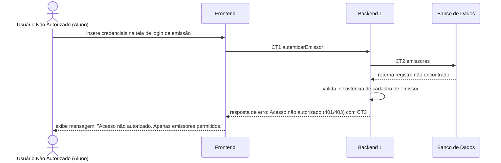

# Fluxo do E1: Acesso restrito à área do emissor

**Feito quando (da Entrega 1):** Um usuário não autorizado (ex: aluno) faz a tentativa de acessar a área de emissão e o sistema bloqueia o acesso, permitindo apenas emissores.

**Passos:**
- O usuário não autorizado (ex: Aluno) acessa a tela de login da área de emissão e insere credenciais (e-mail e senha).
- O Frontend chama o Backend 1 com a operação `autenticarEmissor` (CT1).
- O Backend 1 consulta na coleção do Banco de Dados se o usuário existe e se as credenciais conferem com a operação `emissores` (CT2).
- O Banco de Dados responde que o registro não foi encontrado / credenciais não conferem para o Backend 1.
- O Backend 1 valida o retorno e responde ao Frontend com erro de acesso não autorizado (CT3).
- O Frontend exibe a mensagem de bloqueio: "Acesso não autorizado. Apenas emissores cadastrados podem acessar esta área."

**Diagrama:**

**Contratos usados:**
- CT1 autenticarEmissor
- CT2 consultarEmissor
- CT3 respostaAutenticao