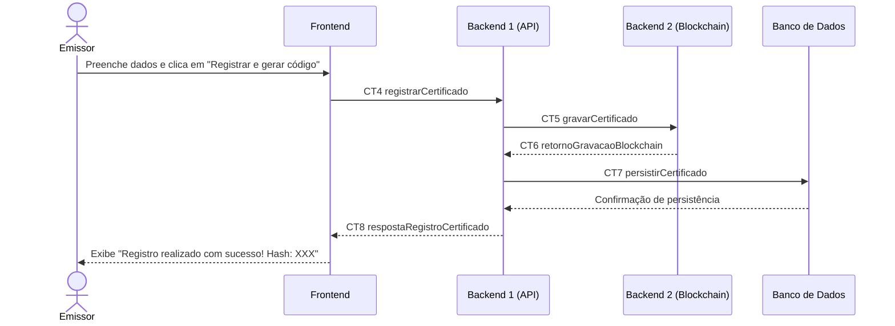

# Fluxo do E2: Registro do certificado

**Feito quando (da Entrega 1):** O emissor formalizado faz o preenchimento dos dados obrigatórios de um aluno e o certificado é registrado na blockchain com uma chave única. 

**Passos:**
- O emissor preenche os campos do formulário (nome, curso, etc.) e clica em "Registrar e gerar código". 
- O Frontend envia a requisição para o Backend 1 com a operação registrarCertificado (CT4). 
- O Backend 1 valida o emissor e envia a transação para o Backend 2 (Blockchain) com a operação gravarCertificado (CT5). 
- O Backend 2 (Blockchain) processa a transação e devolve o hash único gerado para o Backend 1 (CT6). 
- O Backend 1 salva os metadados do certificado e o hash no Banco de Dados (CT7). 
- O Backend 1 responde ao Frontend com mensagem de sucesso e o hash (CT8). 
- O Frontend exibe: "Registro realizado com sucesso! Hash: [XXX]". 

**Diagrama:**

**Contratos usados:**
- CT4 registrarCertificado
- CT5 gravarCertificado
- CT6 retornoGravacaoBlockchain
- CT7 persistirCertificado
- CT8 respostaregistroCertificado