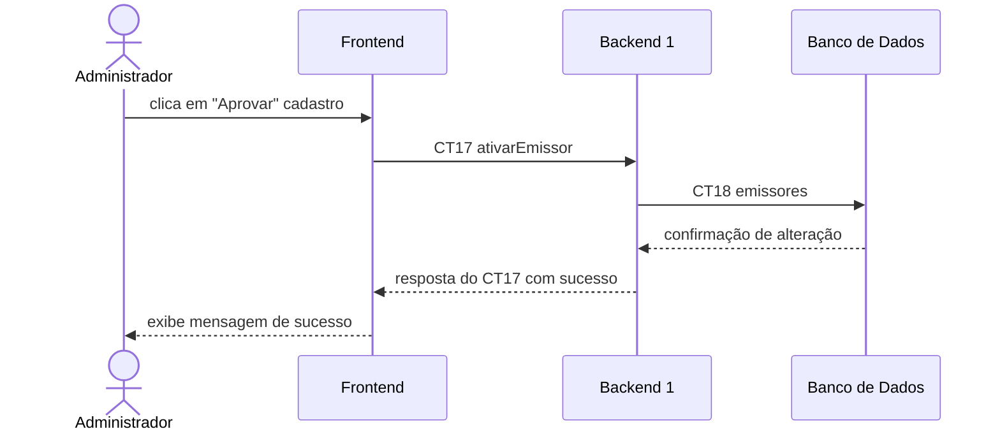

# Fluxo do E5: Cadastrar e validar novos emissores no sistema

**Feito quando (da Entrega 1):** O administrador do sistema faz a análise da documentação de uma instituição/MEI e o perfil do emissor é ativado para uso na plataforma.

**Passos:**
- O Administrador acessa a lista de emissores pendentes e clica em “Aprovar” em um cadastrado.
- O Frontend chama o Backend 1 com a operação `ativarEmissor` (CT17).
- O Backend 1 atualiza o status desse usuário para “ativo” na coleção de emissores no Banco de Dados com a operação `emissores` (CT18).
- O Banco de Dados confirma a gravação do novo status para o Backend 1.
- O Backend 1 responde ao Frontend com mensagem de sucesso.
- O Frontend exibe na tela a mensagem “Emissor ativado com sucesso” para o Administrador.

**Diagrama:**

**Contratos usados:**
- CT17 ativarEmissor
- CT18 coleOEmissores