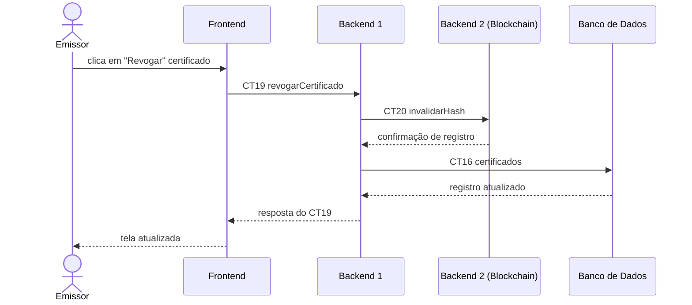

# Fluxo do E6: Permitir a revogação de certificados emitidos

**Feito quando (da Entrega 1):** O emissor formalizado faz a solicitação de revogação de um certificado no painel e o status do documento é atualizado para “inválido” nas consultas.

**Passos:**
- O Emissor clica no botão “Revogar” ao lado de um certificado na lista do painel.
- O Frontend chama o Backend 1 com a operação `revogarCertificado` (CT19).
- O Backend 1 repassa a instrução para o Backend 2 (Blockchain) com a operação `invalidarHash` (CT20).
- O Backend 2 registra a revogação e devolve a confirmação para o Backend 1.
- O Backend 1 atualiza o status do certificado no Banco de Dados para “inválido” com a operação `certificados` (CT16).
- O Banco de Dados confirma a atualização do registro para o Backend 1.
- O Backend 1 responde ao Frontend com mensagem de sucesso.
- O Frontend atualiza a visualização do certificado na tela para o Emissor.

**Diagrama:**

**Contratos usados:**
- CT16 coleOCertificados
- CT19 revogarCertificado
- CT20 invalidarHash