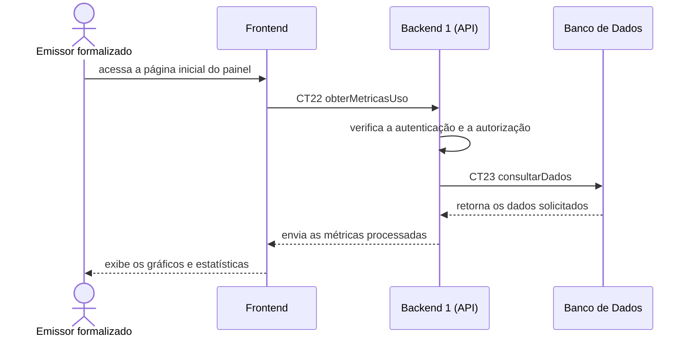

# Fluxo do E8: Exibir métricas e estatísticas de uso no painel

**Feito quando (da Entrega 1):** O emissor formalizado faz a navegação para a página inicial do painel e o sistema exibe gráficos com o total de certificados emitidos e consultados.

**Passos:**
- O emissor formalizado acessa a página inicial do painel pela interface do sistema.
- O Frontend solicita ao Backend 1 (API) as métricas e estatísticas de uso do sistema com a operação `obterMetricasUso` (CT22).
- O Backend 1 verifica a autenticação e a autorização do emissor.
- O Backend 1 consulta o Banco de Dados para obter a quantidade total de certificados emitidos e consultados com a operação `consultarDados` (CT23).
- O Banco de Dados retorna os dados solicitados ao Backend 1.
- O Backend 1 organiza os resultados e responde ao Frontend.
- O Frontend apresenta gráficos com o total de certificados emitidos e consultados na página inicial do painel para o Emissor formalizado.

**Diagrama:**

**Contratos usados:**
- CT22 obterMetricasdeUso
- CT23 consultarDadosdeMetricas